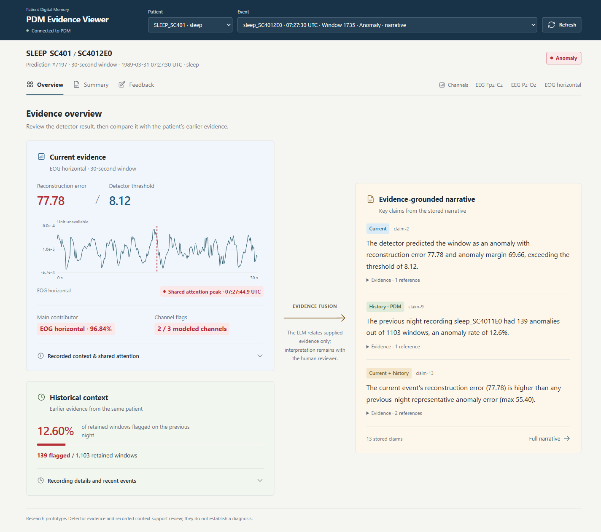

# Patient Digital Memory and Evidence Fusion

Research code accompanying *From Episode-Level XAI to Longitudinal Interpretation: A Patient Digital Memory and Evidence-Fusion Framework for Medical Time-Series Monitoring*.

The framework combines time-series anomaly detection with a Patient Digital Memory (PDM). It stores signal observations, model evidence, and earlier findings in PostgreSQL/TimescaleDB, then uses current and historical evidence to generate grounded narratives. The [web viewer](viewer/) presents the evidence and records event-specific human feedback.



## Repository guide

| Path | Contents |
| --- | --- |
| [models](models/README.md) | Dataset-specific model, training, evaluation, and preprocessing code |
| [pdm](pdm/) | Detector, PDM storage, evidence retrieval, and narrative generation |
| [scripts](scripts/README.md) | Data preparation and experiment entry points |
| [schemas](schemas/) | TimescaleDB schema and migrations |
| [viewer](viewer/) | Flask API, browser interface, and feedback storage |
| [outputs](outputs/README.md) | Saved model metadata, evidence, scoring, and measurements |

The five datasets are [CHB-MIT EEG](https://physionet.org/content/chbmit/1.0.0/), [Apnea-ECG](https://physionet.org/content/apnea-ecg/1.0.0/), [Sleep-EDF](https://physionet.org/content/sleep-edfx/1.0.0/), [UCI HAR](https://archive.ics.uci.edu/dataset/240/human+activity+recognition+using+smartphones), and [synthetic thermal signals](https://github.com/malik630/Data-Wrangling/tree/9293a0674f577ff7df419bc10782b7a2d1ab9be9/data/raw). Dataset-specific inputs and entry points are documented under [models](models/README.md). Raw datasets and trained weights are not included.

## Method and reported results

MedAttnAID combines a bidirectional LSTM autoencoder, temporal attention, and a clinical pattern loss. The PDM retains its reconstruction and attention evidence alongside patient history for evidence-grounded narrative generation.

The accompanying manuscript reports these window-level F1 scores and gains over a standard BiLSTM autoencoder (Tables 2–3):

| Dataset | F1 (%) | Gain (percentage points) |
| --- | ---: | ---: |
| Apnea-ECG | 62.48 | +10.68 |
| UCI HAR | 53.80 | +8.70 |
| Synthetic thermal | 85.10 | +10.80 |
| CHB-MIT EEG | 82.60 | +14.20 |
| Sleep-EDF | 76.70 | +12.60 |

In a paired comparison of 16 Apnea-ECG cases, mean evidence coverage increased from 80.58% with current evidence alone to 88.99% with PDM history; unsupported patient-specific claims decreased from 5.00% to 0.00% (Table 7). The conditions had different amounts of available evidence. These are research results, not clinical validation. See the saved [narrative results](outputs/paper_source_bundle/source_files/table7_results.json).

## Reproducing reported results

The Table 2 F1 scores are reported in the paper. Raw datasets, prepared inputs, and trained weights are not bundled, so a fresh checkout cannot reproduce every score.

| Result | Code and required input | Current limitation |
| --- | --- | --- |
| Apnea-ECG · 62.48% | [Notebook workflow](models/apnea_ecg/code/training_and_baselines.ipynb); 60-second windows in `.npz` or PostgreSQL | Raw recordings, window cache, database ingestion, and weights are absent; companion Python files depend on notebook state. |
| CHB-MIT EEG · 82.60% | [MedAttnAID code](models/chb_mit/code/src/medattnaid/); cleaned EEG in PostgreSQL/TimescaleDB | EDF ingestion and a prepared database are absent. |
| Sleep-EDF · 76.70% | [Model code](models/sleep_edf/code/); processed `sleep_edf_processed.npy` | Preprocessing and weights are absent. This routine uses a different split from the PDM patient-held-out experiment. |
| UCI HAR · 53.80% | [Code folder](models/uci_har/code/) and [reference trainer](models/uci_har/reference/train.py); official inertial-signal files | The reference trainer is reconstructed and does not reproduce the reported score. The code-folder trainer is incomplete and has a random-data fallback. |
| Synthetic thermal · 85.10% | [Thermal code](models/synthetic_thermal/code/) and [preprocessing](models/synthetic_thermal/preprocessing/); thermal CSVs or prepared windows | The CSV cleaning pipeline is included; the original signal generator and trained weights are absent. |

The separate PDM pipeline covers patient-held-out Apnea-ECG and Sleep-EDF experiments. Its entry points are listed in [scripts](scripts/README.md); saved fold metadata and decisions are under [outputs/detector_training](outputs/detector_training/). Model weights and raw signal arrays are not included.

For the paired narrative comparison on 16 Apnea-ECG cases, see the saved [Table 7 results](outputs/narrative_experiments/scoring/apnea_paired_v7_contextual_freegen_20260917T200000Z/fusion-scoring-v7/table7_results.json) and [experiment artifacts](outputs/narrative_experiments/).

## Run the PDM and viewer locally

The application uses Python, TensorFlow CPU, Flask, and PostgreSQL/TimescaleDB. Individual model folders list their own dependencies.

```powershell
python -m venv .venv
.\.venv\Scripts\Activate.ps1
pip install -r requirements.txt
Copy-Item .env.example .env
docker volume create JAISE2026_pdm_project_pgdata
docker compose up -d
python -m pdm.db
python -m viewer.feedback
python viewer/app.py
```

Open `http://127.0.0.1:5000`. Database settings are in [.env.example](.env.example); the default port is `5433`. A fresh database has no patient events until data and model outputs are populated. Generating new narratives requires an LLM API key; viewing stored results does not.

The [saved outputs](outputs/README.md) document completed experiments but do not replace the database or model weights. Dataset access and reuse terms remain with their providers.

## License

This repository is licensed under the [MIT License](LICENSE). The included Heroicons retain their [Tailwind Labs copyright notice](viewer/static/icons/LICENSE.txt).
